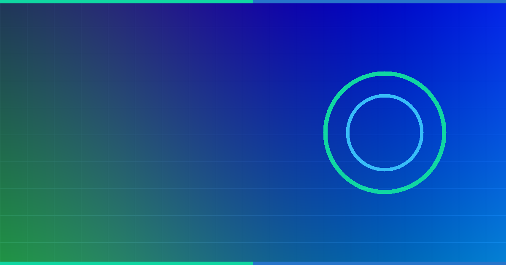
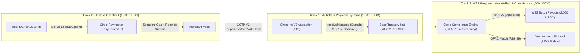

# DoraHacks × Circle — Circle Developer Bounties (`1,500 USDC` Cash / Track — Group 2 Closing Oct 31, 2026 & Group 3 Nov 1 – Dec 31, 2026)



- **Official Bounty Portal:** https://dorahacks.io/hackathon/circle-developer-bounties-1/detail
- **Group 2 Window:** September 1 – **October 31, 2026** (Imminent Deadline — 5 Days Left!)
- **Group 3 Window:** November 1 – December 31, 2026
- **Cash Prize Pool:** **`1,500 USDC` Cash per winning project per challenge track** (`$4,500+ USDC` combined across the 3 core tracks)
- **Verification SHA-256:** `af6600d9f1ad3bb02d03c7380205a59b55ecb7c2c4f0a590d62eede5650553ec`

---

## 1. System Architecture (`CircleOmniFlow`)



---

## 2. Track-by-Track Verification Summary

1. **Track 1 (`1,500 USDC` — Multichain Payment Systems via CCTP V2):** Sweeps surplus USDC from Arbitrum (`Domain 3`: `32,500 USDC`), Solana (`Domain 5`: `23,800 USDC`), and Polygon PoS (`Domain 7`: `14,200 USDC`) into Base (`Domain 6`) with `1 bps` Fast Transfer fee (`70,500.00 USDC` burned $\to$ `7.05 USDC` fast fee + `70,492.95 USDC` net minted).
2. **Track 2 (`1,500 USDC` — Gasless Experiences via Circle Paymaster):** Executes an `85.00 USDC` merchant checkout from an EIP-4337 Smart Contract Account holding `0.00 ETH`, paying `0.003160 USDC` in gas via off-chain EIP-2612 `USDC.permit` with automatic `postOp` refund (`0.001497 USDC`).
3. **Track 3 (`1,500 USDC` — Programmable Wallets, Compliance Engine & SDK Feedback Bounty):** Enforces atomic pre-payout address screening (`2` clean vendors approved for `2,050.00 USDC`, `1` OFAC sanctioned cluster blocked for `5,000.00 USDC`) and includes 3 engineering feedback reports (`CIRCLE-FB-01` .. `CIRCLE-FB-03`).

---

## 3. Reproducible Verification (`exit code 0`)

```bash
python DoraHacksCircleDevBounties2026/circle_dev_bounties_engine.py
```
